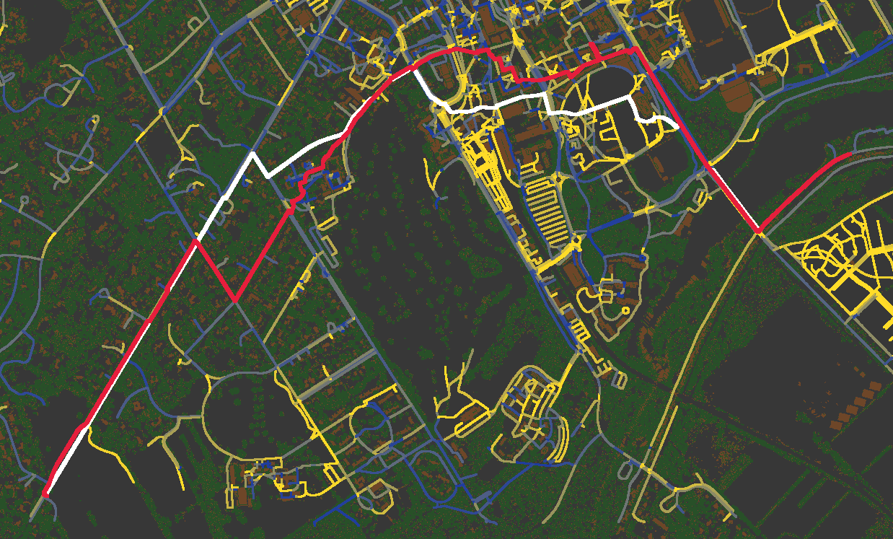

# Equid

**A map for how you are right now.** Normal maps measure distance in metres or minutes. Equid measures it the way
*you* feel it (hills, steps, shade, lit streets at night, benches, a stroller or a wheelchair) and redraws the map
around you, so "close" means close for you.

HackPrinceton Fall 2026 · Healthcare track · demo regions: Princeton, NJ and Houston, TX.



## How it works
1. **Streets have features**, all ≥ 0: walking time, climb, steps, rough surface, busy road, unlit, sun (LiDAR shade by
   time of day), flood zone, crossings, no sidewalk, distance to a bench or toilet, … (20 in all).
2. **You pick weights** (or a preset: wheelchair, stroller, shady, night, …, or ask the AI in plain English).
   Your cost of a street = Σ weightᵢ × featureᵢ.
3. **Shortest paths from you.** Dijkstra (Rust, compiled to WebAssembly, in your browser) gives your cost to every
   street and place. Sliders update the map live; the *warp* and *3D* views bend the map so distance = your cost.

## Run it
Needs Rust + `wasm32-unknown-unknown`, `wasm-bindgen-cli` **0.2.117**, Node 20+.

```sh
rustup target add wasm32-unknown-unknown
cargo install wasm-bindgen-cli --version 0.2.117
cargo test --workspace
cd web && npm install && npm run dev        # http://localhost:5173
cargo run --release -p server               # AI trip panel on :8787 (EQUID_DATA=data/princeton)
```
Windows: `.\build.ps1`, then `.\run.ps1`. No Claude key → the AI panel runs on an offline mock model with the same tool loop.

## What the Lean proof shows (and what it doesn't)
[`proof/`](proof/README.md) proves in Lean 4 that all 20 features are ≥ 0, so **any** weights ≥ 0 (a preset, your
sliders, or the AI's) give a valid Dijkstra metric. The engine's feature code is **generated from the proven formulas**
and tested bit-for-bit against the hand-written version.

Not proven: floating-point rounding (proofs are over exact rationals), data quality (whether a street really is lit),
the hand-written field reader, and Dijkstra itself (textbook petgraph; we prove its precondition).

## Credits
**Data**
- Streets, places, objects: © [OpenStreetMap](https://www.openstreetmap.org/copyright) contributors (ODbL), via the Overpass API
- Elevation: USGS 3DEP 1/3 arc-second (ned10m), via [OpenTopoData](https://www.opentopodata.org/)
- Shade, trees, sunset and stargazing spots: USGS 3DEP LiDAR (public domain), Entwine Point Tiles on AWS
- Flood zones: FEMA National Flood Hazard Layer
- Aerial object detection (Houston: parking lots, tennis courts, solar panels): [Vexcel](https://vexcel.com/)
- Homes and apartments (Houston, local only, not in this repo): CoStar data kit, with Matterport 3D tours
- Basemap: [OpenFreeMap](https://openfreemap.org/) (OpenMapTiles, OSM data)
- Sunrise/sunset: NOAA solar position formulas

**Software**
- AI trip agent: [Claude](https://www.anthropic.com/claude) (Anthropic API, tool use)
- Proofs: [Lean 4](https://lean-lang.org/)
- Engine: Rust, [petgraph](https://github.com/petgraph/petgraph), serde / serde_json, wasm-bindgen
- Web: [deck.gl](https://deck.gl/), [MapLibre GL JS](https://maplibre.org/), Vite, TypeScript
- Server: axum, tokio, reqwest, tower-http
- Data prep: las (LAZ), ureq, rayon, png

Built with help from Claude Code agents.

## Repo
| path | what |
|---|---|
| `engine/` | Rust: features, metrics, Dijkstra, views; native + WASM |
| `web/` | the app (Vite + TS, deck.gl); internals in [docs/web.md](docs/web.md) |
| `server/` | AI trip agent (Claude tool use over the engine) |
| `prep/`, `prep-shade/` | data builders (OSM, elevation, flood, LiDAR shade) |
| `proof/` | Lean 4 proofs + Rust code generator |
| `data/` | prepared regions, presets, test fixture |
| `docs/contracts.md` | file formats, features, WASM and agent APIs |
